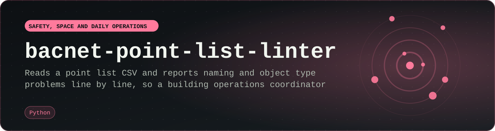
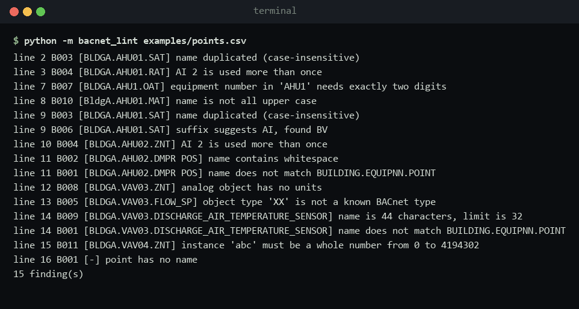

<p align="center"></p>

# bacnet-point-list-linter

[](https://github.com/yassine2med/bacnet-point-list-linter/actions/workflows/ci.yml)  

A controls contractor hands over a BACnet point list, and the names are inconsistent: `AHU1` next to `AHU01`, mixed case, spaces, two points with the same object instance, a supply air temperature set up as a binary value. Those errors surface later as broken graphics, trend logs and alarms. This command line tool reads a point list CSV and reports naming and object type problems line by line, so a building operations coordinator can send a clear correction list back to the contractor.



## What it is for

A controls contractor hands over a BACnet point list (the list of sensors, setpoints and commands the building automation system reads and writes), and the names are inconsistent or mistyped. Building operations coordinators, controls engineers and commissioning agents use this tool to check the list before the graphics, trend logs and alarms are built on it. They get a line by line list of naming and object type problems to send back to the contractor.

## Install

```
git clone <this repo> && cd bacnet-point-list-linter
python -m pip install -r requirements.txt
python -m pytest -q
```

## How to use

| I want to | Command |
|---|---|
| Lint a point list CSV | `python -m bacnet_lint examples/points.csv` |
| Allow a different maximum name length (default 32) | `python -m bacnet_lint examples/points.csv --max-length 40` |
| Show help | `python -m bacnet_lint --help` |

Exit code 1 when findings exist, 0 when clean, 2 when the file cannot be read. Input columns: `object_type, instance, name, units`. The sample file is invented (Building A, AHU and VAV units).

Example:

```
python -m bacnet_lint examples/points.csv
```

Output:

```
line 2 B003 [BLDGA.AHU01.SAT] name duplicated (case-insensitive)
line 3 B004 [BLDGA.AHU01.RAT] AI 2 is used more than once
line 7 B007 [BLDGA.AHU1.OAT] equipment number in 'AHU1' needs exactly two digits
line 8 B010 [BldgA.AHU01.MAT] name is not all upper case
line 9 B003 [BLDGA.AHU01.SAT] name duplicated (case-insensitive)
line 9 B006 [BLDGA.AHU01.SAT] suffix suggests AI, found BV
line 10 B004 [BLDGA.AHU02.ZNT] AI 2 is used more than once
line 11 B002 [BLDGA.AHU02.DMPR POS] name contains whitespace
line 11 B001 [BLDGA.AHU02.DMPR POS] name does not match BUILDING.EQUIPNN.POINT
line 12 B008 [BLDGA.VAV03.ZNT] analog object has no units
line 13 B005 [BLDGA.VAV03.FLOW_SP] object type 'XX' is not a known BACnet type
line 14 B009 [BLDGA.VAV03.DISCHARGE_AIR_TEMPERATURE_SENSOR] name is 44 characters, limit is 32
line 14 B001 [BLDGA.VAV03.DISCHARGE_AIR_TEMPERATURE_SENSOR] name does not match BUILDING.EQUIPNN.POINT
line 15 B011 [BLDGA.VAV04.ZNT] instance 'abc' must be a whole number from 0 to 4194302
line 16 B001 [-] point has no name
15 finding(s)
```

## How it works

- The convention checked is `BUILDING.EQUIPNN.POINT`, upper case, with a two digit equipment number, for example `BLDGA.AHU01.SAT`.
- B001 to B003, B007, B009, B010: name presence, pattern, whitespace, duplicates, equipment number digits, length and case.
- B004, B005, B011: the object type must be one of AI, AO, AV, BI, BO, BV, MSI, MSO, MSV, the instance must be a whole number up to 4194302, and a type plus instance pair must be unique.
- B006: the last name segment is matched to a small suffix table (`SAT`, `RAT`, `OAT`, `MAT`, `ZNT`, `SP`, `CMD`, `STS`, `ALM`). A suffix such as `_SP` must be an AV or AO, `_CMD` an AO or BO, and so on.
- B008: analog objects (AI, AO, AV) need units.

## Limits

- It reads a CSV list. It does not talk to a BACnet network or read an EDE file.
- The naming convention and suffix table are fixed in `linter.py`. A different site standard needs a code change.
- It does not check that point lists match the equipment on a drawing.

## License

MIT. See LICENSE. Yassine Emhamed, 2026.
